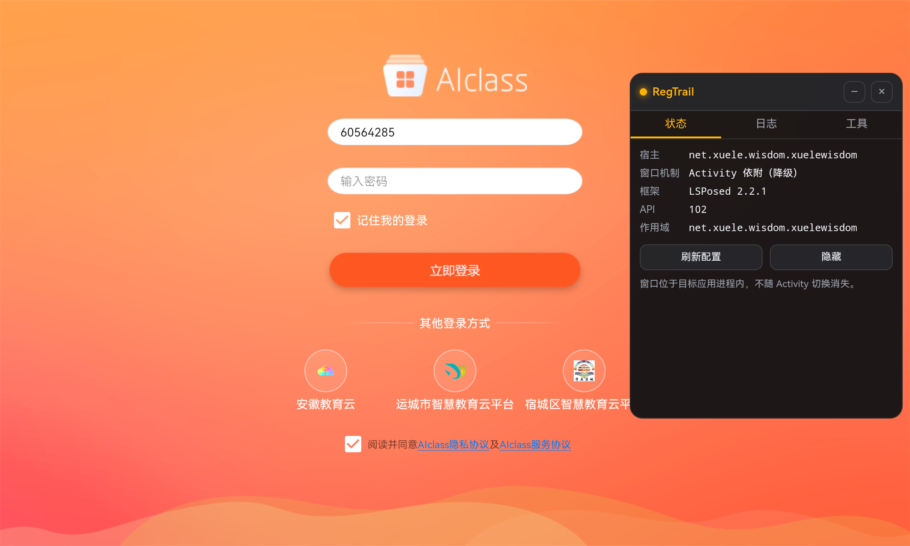

<div align="center">


# RegTrail

**安卓逆向与实时分析工作台** — Root + LSPosed 注入,悬浮窗常驻于目标应用之上。

一个设置端 App 负责选目标、配色、下发配置;一个极小的 payload 注入目标进程,
在目标应用里提供悬浮窗、对象/方法访问、内存搜索与 AI Agent。

[](LICENSE)
[-3ddc84.svg)](#环境要求)
[](#环境要求)
[](#验证状态)

</div>

---

> [!WARNING]
> RegTrail 会注入应用进程、读写内存、Hook 方法,并可能导出**重新签名**的应用安装包。
> 仅用于**你自己的应用**或**已获授权**的安全研究。用它修改第三方应用可能违反其服务条款,
> 重新分发修改后的应用可能侵犯著作权。风险自负,详见 [免责声明](#免责声明)。

## 目录

- [它解决什么问题](#它解决什么问题)
- [功能](#功能)
- [截图](#截图)
- [工作原理](#工作原理)
- [环境要求](#环境要求)
- [构建](#构建)
- [使用](#使用)
- [验证状态](#验证状态)
- [已知限制与风险](#已知限制与风险)
- [目录结构](#目录结构)
- [文档](#文档)
- [许可与免责](#许可与免责)

## 它解决什么问题

传统做法是把 APK 拖到电脑上,反编译、读 smali、找方法、改、重打包、安装、试。
一次尝试要来回好几分钟,而且你看到的永远是**静态快照**。

RegTrail 把这件事搬回设备上,并且变成**在线**的:

- 悬浮窗跟着目标应用走,切页面不消失 —— 你可以在真实运行的应用上直接操作;
- 搜类、搜方法、挂 Hook、看**参数和返回值**,立刻生效,不用重启宿主;
- 想改一个数值?内存搜索 → 二次收敛 → 写入 → 读回校验 → 可还原;
- 一次成功的交互式调试可以**存成脚本**,挂到 `AppOnCreate` / `ActivityOnResume` /
  `ClassLoaded` 等时机,下次注入自动执行;
- 不想给 root?把悬浮窗**打进 APK 里重新签名导出**,装到普通设备上也能用。

设置端有完整的 AI Agent:它能调用同一套工具,于是"帮我找这个界面上显示的金币数存在哪"
这种探索可以由模型代劳。

## 功能

| 模块 | 能力 |
|---|---|
| **注入** | 现代 LSPosed 模块契约(API 102)。两种悬浮窗机制见下 |
| **悬浮窗** | WebView UI(资源来自模块 APK,零网络请求)。**可自由缩放**、标题栏/药丸可拖动、可折叠为药丸、位置与尺寸持久化。5 个页签:状态 / 日志 / 内存 / 调试 / 工具 + Agent |
| **作用域** | 枚举已安装应用、批量申请/移除 LSPosed 作用域、逐应用悬浮窗开关 |
| **内存搜索** | 目标进程内扫描(`/proc/self/mem`,被拒时降级 `sun.misc.Unsafe`),int32/int64/float32/float64/utf8、二次收敛、写入 + 读回校验 + **原值还原**;设置端另有 root 侧扫描器 |
| **实时调试** | 类/方法搜索(含继承链)、挂 Hook、实时查看**每次调用的参数与返回值**、改写返回值(原方法仍执行,副作用保留)、Hook 列表与命中计数 |
| **脚本** | 磁盘脚本库 + **append-only 版本历史**(每次保存新增版本,回滚不丢历史)、导出/导入整包;7 种触发时机 × 6 种动作 |
| **Agent** | OpenAI 兼容协议的 ReAct 循环,设置端与悬浮窗内各一个;工具可在目标进程内执行;**思考等级**可调(DeepSeek thinking mode);每步工具调用可折叠查看 |
| **终端** | 4 种模式(Root / 应用沙箱 / 宿主上下文 / 联网工作区),持久 shell |
| **免 Root 打包** | 复制目标 APK → 改写二进制 AXML(`appComponentFactory`)→ 注入 payload dex 与 UI 资源 → apksig v2/v3 重签名 → 导出可安装的增强包 |

### 两种悬浮窗机制

| 机制 | 前提 | 特点 |
|---|---|---|
| **内嵌式(DecorView)** — 默认 | 无 | 不需要任何权限、**不碰 system_server**,最坏只影响该目标应用。会被系统栏裁剪 |
| **免权限悬浮窗** — 需显式开启 | `system` 作用域 + 二次风险确认 | `TYPE_APPLICATION_OVERLAY` + null token 绕过 `SYSTEM_ALERT_WINDOW`,应用级常驻。**需要 Hook system_server,有开机卡 logo 风险** |

默认永远是**内嵌式**。切换到后者需要先勾选机制、再确认风险对话框;模块侧还有第二道闸门
(`overlayMechanism == ApplicationOverlay` **且** `systemHookAcknowledged == true`),否则拒绝 Hook。

## 截图

<div align="center">
  
  <br>
  <sub>悬浮窗常驻在目标应用之上,显示宿主包名、机制、框架版本、API 与作用域</sub>
</div>

## 工作原理

```
┌─ 设置端 App (io.github.wg1337.RegTrail) ─────────────┐
│ Compose + M3。选目标、配色、Agent、脚本库、打包        │
│            │                                          │
│            │ ① root 写配置                           │
│            ▼                                          │
│  /data/local/tmp/regtrail/config.json  (0644)         │
└────────────┬──────────────────────────────────────────┘
             │ ② 目标进程读取(只读)
┌────────────▼──────────────────────────────────────────┐
│ LSPosed 注入的模块 (同一份 APK)                        │
│  onModuleLoaded → 读配置 → 判定是否本进程为目标        │
│  Hook Application.attach → 拿到 Context               │
│  → DecorView 悬浮窗 / TYPE_APPLICATION_OVERLAY        │
│  → 调试引擎、内存搜索、脚本引擎、Agent                 │
└───────────────────────────────────────────────────────┘
```

- **配置通道**:设置端用 root 把 JSON 原子写入 `/data/local/tmp/regtrail/config.json`,
  模块只读。配置里带 `revision`,变更即时生效,不用重启宿主。
- **悬浮窗 UI 资源**:网页 UI 从**模块自己的 APK** 里读(不联网、不走 CDN),
  WebView 通过 `shouldInterceptRequest` 在虚拟源 `https://regtrail.local/` 上提供。
- **免 Root 打包**用 `AppComponentFactory` 而不是替换 `Application`:后者要靠反射调
  `Application.attach/onCreate`,在 Android P+ 会被隐藏 API 限制挡住。

更多设计取舍(为什么不用 KMP、为什么只支持 LSPosed、apktool 为何不能在 Android 上跑等)
见 [docs/PLAN.md](docs/PLAN.md)。

## 环境要求

| 项 | 要求 |
|---|---|
| Android | 8.1+(`minSdk 27`);免 Root 包需要 API 28+(`AppComponentFactory`) |
| 框架 | **LSPosed API 102**(v2.2.x 系列)。其它 Xposed 实现未适配 |
| Root | 设置端需要 root 写配置与读取目标 APK。**APatch / Magisk / KernelSU 均可用** |
| 构建 | JDK 21、Android SDK 37、Gradle wrapper 自带 |

## 构建

```bash
git clone https://github.com/wg-1337/RegTrail.git
cd RegTrail
# local.properties 里指向你的 SDK,例如:
#   sdk.dir=F:\\Android\\androidsdk
./gradlew :app:assembleDebug
```

产物:`app/build/outputs/apk/debug/app-debug.apk`。

其它常用命令:

```bash
./gradlew :app:testDebugUnitTest   # 单元测试(脚本库、行区间编辑、思考参数等)
./gradlew clean :app:assembleDebug # 干净重建
```

## 使用

1. **安装并激活模块** — 装好 App,在 LSPosed 管理器里启用 RegTrail,勾选目标应用作为作用域,然后**重启设备**。
   > 模块 APK **内容**变化后必须重启,LSPosed 会按 APK 路径缓存 dex;只重装同一份包则不必。
2. **授权 Root** — 打开 App,按首页提示授予 root。APatch 上 `libsu.isAppGrantedRoot()` 恒为 `false`
   (它只读 Magisk 的 `magisk.db`),以首页的「已获得 Root」状态为准。
3. **选目标** — 「目标」页勾选应用的作用域,并打开对应的「悬浮窗」开关。
4. **打开目标应用** — 悬浮窗应当出现。若没有,先在「设置 → 环境」里跑一次自检看诊断。
5. **开始工作** — 悬浮窗里切到 内存 / 调试 / 工具 / Agent 页签。
6. **(可选)导出免 Root 包** — 「设置 → 打包」选择目标应用生成。

> 💡 首次进入「目标」页时,部分国产 ROM 会额外弹一次「是否允许读取已安装应用列表」,
> 批准后**还要再重启一次 App** 才会生效。

## 验证状态

诚实说明每个功能被验证到什么程度:

| 功能 | 验证程度 |
|---|---|
| 悬浮窗注入(DecorView) | ✅ 真机验证:注入、显示、主题色、JS 桥、跨 Activity 几何不变 |
| 作用域申请 / 应用枚举 / 配置下发 | ✅ 真机验证 |
| 内存搜索(进程内) | ✅ 真机验证:扫描 → 收敛 → 写入校验 → 还原 |
| 实时调试(参数/返回值) | ✅ 真机验证:挂 Hook、抓到参数与返回值、解除 |
| 悬浮窗缩放 / 拖拽 / 折叠 | ✅ 真机验证(抓手**宽度**方向仍有已知缺陷,见下) |
| 免 Root 打包流水线 | ⚠️ JVM 端到端验证(`apksigner verify` / `zipalign -c -P 16` / AXML 断言通过);**未在设备上安装验证** |
| 脚本库 + 版本历史 | ⚠️ 50 个单元测试通过;**未上机验证** |
| Agent(设置端 / 悬浮窗内) | ⚠️ 结构验证;**未用真实模型端点跑通** |
| 终端 | ⚠️ 启动链路验证;交互未覆盖 |

## 已知限制与风险

**风险**

- **`system` 作用域可能导致开机卡 logo。** system_server 在启动路径上,那里的 Hook 出错会让
  设备停在开机画面,而你**无法打开 App 去关掉它**。所以免权限悬浮窗默认关闭、需二次确认。
  恢复方式:LSPosed 安全模式、Recovery 删除 `/data/adb/modules/zygisk_lsposed`、或清数据。
- **免 Root 包过不了 Play Integrity**,且会失去应用自更新能力,安装前需卸载原版(会丢数据)。
  加固/加壳的 APK 会失败。
- **进程内内存搜索的 `Unsafe` 传输按裸地址解引用。** 如果某内存页在读取与访问之间被解除映射,
  会 SIGSEGV 直接杀死目标进程(Java 无法捕获)。已用页级读取 + 只访问 `maps` 列出的区域做缓解,
  但无法消除。
- **Agent 的 API key 会随 `config.json` 下发**,而该文件是 `0644`——同机任何应用只要知道路径就能读到。

**限制**

- 抓手拖拽的**宽度方向**存在已知缺陷:面板右锚定导致 `clientX` 反馈放大(高度正常)。
- 切换 Activity 时标签页与日志滚动位置的历史实现会重置,已加 `localStorage` 持久化但未上机验证。
- 终端目前是行模式,不是完整 PTY。
- 只支持 LSPosed;`lspctl` 仅用于人工排障,不用于程序化控制。

## 目录结构

```
RegTrail/
├─ app/                    设置端 App + LSPosed 模块(同一份 APK)
│  ├─ src/main/java/io/github/wg1337/regtrail/
│  │  ├─ xposed/           模块入口、悬浮窗、调试引擎、内存、脚本、桥
│  │  ├─ agent/            设置端 Agent(ReAct + 工具)
│  │  ├─ patch/            免 Root 重打包流水线
│  │  ├─ memory/           root 侧内存扫描器
│  │  ├─ terminal/         终端会话
│  │  └─ parent/           Compose 宿主、导航
│  ├─ src/main/assets/regtrail/   悬浮窗 WebView UI(HTML/CSS/JS)
│  └─ src/main/resources/META-INF/xposed/   模块声明
├─ payload/                注入免 Root 包的 payload(AppComponentFactory,纯 Java)
├─ shared/                 共享数据模型与 IPC 契约
├─ ui/                     Compose 界面层
└─ docs/                   设计文档与调研记录
```

## 文档

| 文档 | 内容 |
|---|---|
| [docs/PLAN.md](docs/PLAN.md) | 总体设计与决策记录(含真机验证记录、踩坑与自我更正) |
| [docs/lsposed-ecosystem-2026.md](docs/lsposed-ecosystem-2026.md) | LSPosed 生态与 API 调研 |
| [docs/ROOT_TERMINAL_RESEARCH_2026.md](docs/ROOT_TERMINAL_RESEARCH_2026.md) | Root 方案与终端实现调研 |
| [docs/apk-repackaging-2026.md](docs/apk-repackaging-2026.md) | APK 重打包与签名调研 |
| [docs/version-matrix-2026-10-17.md](docs/version-matrix-2026-10-17.md) | 依赖版本矩阵 |

## 许可与免责

以 **AGPL-3.0-or-later** 发布,见 [LICENSE](LICENSE)。

> 本软件仅供学习与研究,以及在你**拥有或已获授权**的应用上进行安全分析。
> 作者不对因使用本软件造成的设备损坏、数据丢失、账号封禁或任何法律后果负责。
> 请勿用于绕过他人应用的付费/授权机制,或重新分发修改后的第三方应用。
